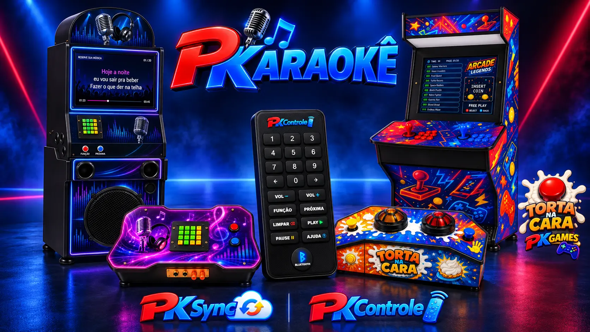

# Lincon Melo

### A técnica conecta. A criatividade transforma.

**[ABRIR MEU PORTFÓLIO →](https://pkaraoke.github.io/pkaraoke/)**

Conecto experiência em **Eletrotécnica, Mecânica Industrial e Informática** ao desenvolvimento de ferramentas para necessidades reais. Minha trajetória reúne manutenção elétrica e eletrônica, diagnóstico de falhas, automação, redes e integração de sistemas.

📍 Itaguaí, Rio de Janeiro · Registro CRT/CFT ativo · Inglês intermediário

[LinkedIn](https://br.linkedin.com/in/linconmelo) · [E-mail](mailto:lincon.melo@gmail.com) · [PKaraokê](https://pkaraoke.com.br)

## Equipamentos e serviços

Meu trabalho também está na **PKaraokê / Karaoke Express**, com fabricação, venda, locação e personalização de equipamentos de entretenimento:

- [Karaokê profissional 3×1](https://pkaraoke.com.br/karaoke.php): karaokê, Jukebox e Bluetooth.
- [Fliperama BarTop EVO](https://pkaraoke.com.br/fliperama.php): jogos retrô e comandos para duas pessoas.
- [Torta na Cara](https://pkaraoke.com.br/torta-na-cara.php): perguntas, botoeiras e sinalização para a disputa.
- [Karaokê Maleta 2×1](https://pkaraoke.com.br/vendas.php): karaokê e Jukebox no formato compacto.

[Loja oficial](https://pkaraoke.com.br/vendas.php) · [Aluguel pela Karaoke Express](https://pkaraoke.com.br/karaokeexpress/) · [Personalização e contato](https://pkaraoke.com.br/contato.php)

## Sistemas que desenvolvo

| Projeto | Propósito | Tecnologias e contexto |
| --- | --- | --- |
| **PKSync** | Sincronização de conteúdo, gestão de equipamentos e comandos entre um servidor e clientes remotos. | PHP, AutoIt, JSON, Ubuntu, Windows |
| **PKControle** | Controle remoto do equipamento de karaokê por uma interface web acessível no celular. | PHP, JavaScript, web, PWA |
| **PKFila** | Organização dos pedidos de músicas e da participação do público nos eventos. | PHP, JavaScript, integração de sistemas |
| **PKaraokê** | Catálogo digital e gestão de eventos, contas e créditos. | PHP, JSON, interfaces responsivas, QR Code |
| **Utilitários próprios** | Processamento de mídia, conversão de imagens e automação de tarefas. | Python, FFmpeg, Bash |

São projetos próprios em desenvolvimento e evolução contínuos. Meu foco é aproximar a operação dos equipamentos da experiência de quem usa o sistema, com atenção à compatibilidade, manutenção e recuperação de falhas.

## Minha base técnica

- **Campo:** manutenção preventiva e corretiva, comandos elétricos, esquemas, medições e diagnóstico de falhas.
- **Infraestrutura:** redes cabeadas e Wi-Fi, telefonia, CFTV, suporte técnico e integração de equipamentos.
- **Desenvolvimento:** PHP, Python, AutoIt, JavaScript, HTML, CSS e Bash aplicados a projetos próprios.
- **Sistemas e dados:** Ubuntu Server, Windows, Apache, JSON e SQLite.

## Trajetória

- **2015–atual:** serviços técnicos como autônomo / MEI em elétrica, eletrônica, tecnologia e automação.
- **2013–2015:** Analista de Suporte Técnico — JCM Telecomunicações.
- **2011–2013:** Analista de Suporte Técnico — Instituto IBCViva, com suporte às PAs de atendimento da OAB RJ — Centro.

Formação técnica em Eletrotécnica, Mecânica Industrial e Informática. Cursos de NR-10/SEP e Comandos Elétricos.

## Vamos conversar

Tenho interesse em oportunidades profissionais e projetos que conectem manutenção, automação, infraestrutura e desenvolvimento.

**Contato:** [lincon.melo@gmail.com](mailto:lincon.melo@gmail.com)
